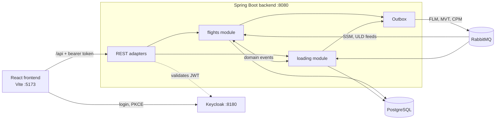

# Air Cargo Operations

A system for planning air cargo flights and loads. A Spring Boot backend, built with Domain-Driven Design, Spring Modulith and hexagonal architecture, processes airline schedule and cargo-booking messages from RabbitMQ and enforces the operational rules. A React + TypeScript frontend lets flight planners and load planners do their work. Users sign in through Keycloak (OpenID Connect).

## Features

- **Flight planning:** register, correct and remove delays (IATA delay codes, 1 minute to 12 hours), with ETD and ETA derived from them. Record actual departure and arrival with validation, following the lifecycle Scheduled → Departed → Landed.
- **Load planning:** a Boeing 747-400 freighter floor plan where ULDs (cargo containers) are placed, moved and removed during a loading window. Automatic load checks cover lateral balance, offloading and unloaded cargo, each with hard or soft warnings. The load can be declared final.
- **Messaging:** incoming schedule (SSM) and ULD booking feeds over RabbitMQ. Duplicates are handled idempotently, and invalid messages go to a dead-letter queue. Outgoing partner messages (FLM, MVT telegrams, CPM) are sent after commit through Spring Modulith's event publication registry, which acts as an outbox. Failed messages are resubmitted automatically when RabbitMQ is back.
- **Security:** an OAuth2 resource server with Keycloak. Every request needs a token, and the roles (`flight-planner`, `load-planner`, `admin`) decide who may change what. The frontend uses Authorization Code + PKCE.
- **Operations:** policy settings stored in the database and changed only by the admin. An hourly retention job removes old flights. Validation errors are returned as `400` ProblemDetails, and refused requests and broker errors are logged.
- **Frontend:** feature-based structure, with server state in TanStack Query (polling every 30 seconds), routing with React Router and an MUI design system. Lint rules enforce the boundaries between features.
- **163 backend tests:** domain rules, message processing, persistence flows with Testcontainers (PostgreSQL, RabbitMQ), security slices, and Spring Modulith architecture verification.

## Tech stack

| Part | Technologies |
|---|---|
| Backend | Java 21, Spring Boot 4, Spring Modulith, Spring Data JPA, Spring AMQP, Spring Security (OAuth2 resource server), Gradle |
| Frontend | React, TypeScript, Vite, TanStack Query, React Router, MUI, keycloak-js, axios, oxlint, pnpm |
| Infrastructure | PostgreSQL, RabbitMQ, Keycloak (with MySQL), Docker Compose |
| Testing | JUnit 5, Testcontainers, Spring Modulith tests, MockMvc |

## Architecture



The backend is one deployable split into Spring Modulith modules per bounded context (`flights`, `loading`, plus supporting modules). Each module follows hexagonal architecture: the domain and application core have no framework dependencies, and adapters for web, persistence and messaging sit around it. Modules collaborate through public APIs and domain events published after commit. `ApplicationModules.verify()` checks the boundaries in a test.

Detailed design notes, written week by week, are in [backend/README.md](backend/README.md) and [frontend/README.md](frontend/README.md).

## Getting started

Prerequisites: Docker, JDK 21, Node.js and pnpm.

```bash
git clone https://github.com/miqqayell/air-cargo-operations.git
cd air-cargo-operations/backend
docker compose up -d       # PostgreSQL, RabbitMQ, Keycloak (realm imported), partner-service mock
./gradlew bootRun          # http://localhost:8080
./gradlew test             # 163 tests (Testcontainers starts its own databases)

cd ../frontend
pnpm install
pnpm dev                   # http://localhost:5173
```

Log in with one of the local Keycloak test users: `t_flight_planner`, `t_load_planner` or `t_admin`, all with password `t_password`. These users exist only in the development realm file and are not real credentials.

To fill the system with demo flights and bookings: `backend/src/test/http/seed-demo-data.sh`.

## What I learned

- **Domain-Driven Design:** bounded contexts, aggregates, value objects and keeping business rules inside the domain model.
- **Modular architecture:** Spring Modulith modules with verified boundaries, and hexagonal ports and adapters.
- **Messaging:** event-driven integration with RabbitMQ, idempotent consumers, dead-letter queues and an outbox via Spring Modulith's event publication registry.
- **Security:** OAuth2/OIDC with Keycloak, JWT validation, role-based authorization and PKCE in a single-page app.
- **React and TypeScript:** structuring a front-end by feature, managing server state with TanStack Query, and typing API data end to end.
- **Testing:** integration tests with Testcontainers and architecture tests.

## Context

University project, KdG Applied Computer Science, Programming 6, 2025-2026. Solo project.

The partner-service mock used in `docker-compose.yaml` is a public Docker image provided for the course.

## Possible improvements

- Optimistic locking, so two planners saving the same flight or load at once don't overwrite each other.
- An adapter that reads incoming MVT telegrams from partners. The date logic is already implemented and tested.
- Further load checks (longitudinal balance, dangerous goods, floor limits) and automatic load planning.
